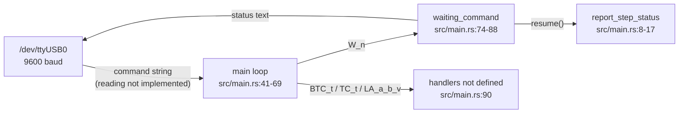

# Tones-PC-RP documentation

Tones-PC-RP is the host-side part of the Tones laboratory instrument. It holds
a Rust program (`src/main.rs`) meant to run on a Raspberry Pi, take protocol
steps as text commands (`W_`, `TC_`, `BTC_`, `LA_`) and report each step's status
over a serial port, plus a Python HTTP listener (`src/listen.py`) that prints the
JSON status messages posted to it. According to the top-level `README.md`, the
rest of the instrument (four STM32L432KC boards and a serial driver) lives in other
repositories. `TODO.md:9` names developers as the target users.

The requirements reverse-engineered from the code are in [`../SPEC.md`](../SPEC.md).

## Status

- Last change to the project's own code: `src/main.rs`, 2024-06-18 (commit
  `4bf9017`); last data file: `protocols.json`, 2024-06-19 (`82dad46`). The
  later commits (2026-08-05 to 2026-11-08) add and remove a licence and add the
  README and the lab tooling. They also move the PNGs to Git LFS and normalise
  line endings. None of them changes `src/` (`git log`).
- **`src/main.rs` cannot compile at this commit (inferred from the source, not
  compiled):** it imports the `serialport` crate (`src/main.rs:1`), which
  `Cargo.toml:8-14` does not declare. It uses `command_str` (`src/main.rs:44`),
  which is never defined, and calls `blocking_temperature_change`,
  `nonblocking_temperature_change` and `liquid_application`
  (`src/main.rs:51,55,64`), which exist only as a placeholder comment
  (`src/main.rs:90`).
- Unfinished in the code: reading commands from the serial port
  (`src/main.rs:42`), the waiting logic (`src/main.rs:75`) and three of the four
  step handlers (`src/main.rs:90`).
- Tests: none. There is no `#[test]` in `src/main.rs`, no Python test file, and
  `.claude/pytest.ini` states that none exist yet.
- CI: the five Gitea workflows under `.gitea/workflows/` run the lab tooling
  checks. None of them builds or runs the project's Rust or Python code (no `cargo` in
  `.gitea/workflows/*.yaml`; `README.md` says Rust is not installed on the gate machine).

## Layout

| Path | Content |
|---|---|
| `src/main.rs` | Rust serial command loop and step status reporting (90 lines) |
| `src/listen.py` | Flask app that accepts a JSON `POST /` and prints it (12 lines) |
| `Cargo.toml`, `Cargo.lock` | Rust package `Tones-PC-RP` 0.1.0 and its dependencies |
| `protocols.json` | Sample list of protocol summaries (id, author, creationDate, description, name) |
| `test.json` | Sample full protocol with steps, liquids and a default wash |
| `diagrams/` | Component diagrams (PC, RP, protocol database) and a use-case diagram, PNG |
| `qa/` | Screenshots from 2024: an open-questions list, a run of `listen.py`, and two code snippets (a Rust state machine and a TypeScript `CommandType` enum) whose source is not in this repository |
| `TODO.md` | Original project brief, a requirements template partly in Russian |
| `recipe.ps1` | Lab tooling entry point (see "Repository tooling") |

## Architecture

At this commit the two programs are not connected to each other. `src/main.rs`
talks only to a serial port. `src/listen.py` only receives HTTP. Nothing reads
`protocols.json` or `test.json`.

- `report_step_status` is a generator from the `generator` crate. It yields
  `"<step> - Processing"`, sleeps 2 s, then yields `"<step> - OK"`, or
  `"<step> - Error"` if the step name is `"Step 3"` (`src/main.rs:8-17`).
- `waiting_command` resumes the generator and writes every status to the
  serial port until a status containing `Error` or `OK` arrives
  (`src/main.rs:74-88`).
- `listen.py` serves `POST /` with Flask in debug mode and prints the JSON body
  (`src/listen.py:5-12`).

History (from `git show e5b4da1:src/main.rs`, 2024-05-01): an earlier version of
`main.rs` parsed `test.json` with `serde` into `Protocol`/`Step` structs, walked
the steps, and POSTed `{"protocol_id", "step_id", "status"}` to
`http://127.0.0.1:5000` with `reqwest`. That is the listener's port. The
screenshot `qa/GET_request_python.png` shows `listen.py` receiving eight such
messages on 2024-05-01. Commit `4bf9017` (2024-06-18) replaced that code with the
serial version. The `serde`, `serde_json`, `serde_with`, `reqwest` and `chrono`
dependencies are left over from it and are unused at this commit.

`diagrams/tones_sendreceive.png` and `diagrams/tones_databaseip.png` show the
intended design: a PC with "Protocols Modifier" and "Protocols ID sender", a
"DB with protocols", and an RP with "Protocols ID receiver" and "Protocols
getter", all linked by `ip:port`. None of these components is implemented here.

## Build and run

Prerequisites, as far as the files state them:

- Rust with edition 2021 (`Cargo.toml:4`). No toolchain version is pinned (no
  `rust-toolchain` file).
- Python with Flask for `listen.py` (`src/listen.py:1`). Flask is not declared
  in any requirements file. The Python version is not stated.

Commands found in the project files:

| Command | Source | Note |
|---|---|---|
| `cargo build --release` | `README.md:40` | Expected to fail at this commit (see Status). Not run here |
| `python src/listen.py` | inferred from `src/listen.py:11-12`; `qa/GET_request_python.png` shows it run with `python3` | Starts the Flask development server, which listens on 127.0.0.1:5000 according to the screenshot |
| `pip install west`, `west init -l path/to/Tones`, `west update` | `README.md:19-21` | Fetches the whole Tones instrument from its manifest repository, which is not part of this repository |

## Configuration

There are no environment variables, config files or CLI flags in the project
code. Every setting is hard-coded:

| Setting | Value | Source |
|---|---|---|
| Serial port | `/dev/ttyUSB0` | `src/main.rs:20` |
| Baud rate | 9600 | `src/main.rs:21` |
| Data bits / stop bits / flow control | 8 / 1 / none | `src/main.rs:22-24` |
| Serial read timeout | 1000 ms | `src/main.rs:34` |
| Simulated step duration | 2 s | `src/main.rs:11` |
| Flask debug mode | on | `src/listen.py:12` |

`recipe.ps1:30-38` loads `.claude/.env` into the environment if it exists. The
project code reads no variables from it.

## Usage

The serial command grammar that `src/main.rs:44-66` dispatches:

| Command | Arguments | Handler |
|---|---|---|
| `W_<time_ms>` | `u64` | `waiting_command` (the time is not used yet) |
| `BTC_<temperature>` | `f32` | `blocking_temperature_change` (not defined) |
| `TC_<temperature>` | `f32` | `nonblocking_temperature_change` (not defined) |
| `LA_<from>_<to>_<volume_ml>` | three `u32` | `liquid_application` (not defined) |
| anything else | - | prints `Unknown command: <command>` |

For example, `W_500` is meant to produce `Waiting Command - Processing`, then
`Waiting Command - OK` two seconds later, both written back to the serial port.
This is derived from the source and has not been observed, because the program
does not compile.

For `listen.py`, send any JSON body with `POST /`. The server prints
`Received POST data: <body>` and answers `200 POST request received!`
(`src/listen.py:7-9`).

## Testing

There are no tests of the project's code. `.\recipe.ps1 test` runs pytest and
ruff over `.claude` only (`recipe.ps1:45-53`) and accepts pytest's "no tests
collected" exit code 5 (`recipe.ps1:48`). It does not touch `src/`.

## Known limitations and problems

- `src/main.rs` does not compile (see Status). `Cargo.lock` also predates the
  `generator` dependency: the root package's entry (`Cargo.lock:6-14`) lists no
  `generator` and no `serialport`.
- The top-level `README.md:3-5` says the program "reads a protocol from the
  database over HTTP, parses it into steps", and `recipe.ps1:12` says the same.
  The code at this commit has no HTTP client call and no JSON parsing. Even the
  2024-05-01 version read `test.json` from disk, not from a database.
- The protocol JSON step types (`Liquid Application`, `Washing`,
  `Temperature Change` in `test.json`) have no mapping to the serial commands.
  `Washing` has no serial command at all.
- A malformed numeric argument stops the program: every parse uses `.unwrap()`
  (`src/main.rs:47,51,55,59-61`), and an `LA_` command with fewer than three
  parts panics on indexing (`src/main.rs:58-61`).
- The `"Step 3"` error branch (`src/main.rs:13`) cannot be reached from `main`,
  which only passes the four fixed step names (`src/main.rs:46,50,54,63`). This
  is an inference from reading the code.
- Status strings are written without a terminator or newline (`src/main.rs:78`).
- `listen.py` runs Flask's development server with the debugger on
  (`src/listen.py:12`).
- The "Lab requirements" link in `README.md:61` points to `127.0.0.1:3000`, a
  local Gitea, so it does not resolve outside the owner's machine.
- Version numbers disagree: `Cargo.toml:3` says 0.1.0, while `recipe.ps1:11`
  says 1.0.0.

## Repository tooling

The repository carries the lab tooling of
[repo-quality-template](https://github.com/IGORSVOLOHOVS/repo-quality-template),
against revision 4.0.0 of the lab requirements, with the exceptions R-02, R-09,
R-13, R-18, R-37, R-41 and R-42 (`README.md:59-61`). Project-specific parts:

- `recipe.ps1:9-17`: `$Name = 'tones-pc-rp'`, `$Code = 'tpr'`,
  `$Version = '1.0.0'`, empty `$Needs`, `$Tools` and `$Provides`, and no `$App`
  ("nothing is installed").
- Verbs that do something: `test` (pytest and ruff over `.claude` only),
  `info` (prints name, code, version, summary) and `clean` (deletes
  `__pycache__`, `.pytest_cache` and `.ruff_cache`). `build`, `install`,
  `uninstall`, `run` and `publish` print `nothing to <verb>` (`recipe.ps1:40-73`).
- Deviation: `.claude/.env` is gitignored and never committed (`CLAUDE.md`
  rule 4, `.gitignore`).
- `.gitattributes` stores `*.png` through Git LFS, which covers `diagrams/` and `qa/`.

## Related documents

- [`../SPEC.md`](../SPEC.md): requirements specification
- [`../README.md`](../README.md): project overview and lab compliance line
- [`../CLAUDE.md`](../CLAUDE.md): rules for working in this repository
- [`../TODO.md`](../TODO.md): original project brief
- [`../diagrams/use-case.png`](../diagrams/use-case.png),
  [`../diagrams/tones_sendreceive.png`](../diagrams/tones_sendreceive.png),
  [`../diagrams/tones_databaseip.png`](../diagrams/tones_databaseip.png): design diagrams

## About this document

Written on 2026-11-18 from commit `3a92e1e` (branch `release`).

Commands run for the check: `git ls-files`, `git log`, `git show` (for the
history of `src/main.rs` and `Cargo.toml`), `git status`, `git remote -v`,
`.\recipe.ps1 info`, `.\recipe.ps1 build`, `cargo --version` (not found: no
Rust toolchain on this machine), and `python -c "import flask"` (not installed).

Not run: `cargo build` (no toolchain, and it would need the network to fetch
crates), `.\recipe.ps1 test` (it rewrites `core.hooksPath` in the git config),
and `src/listen.py` (Flask is not installed, and no servers were started). The
compile failure of `src/main.rs` is therefore inferred from the source, not observed.
